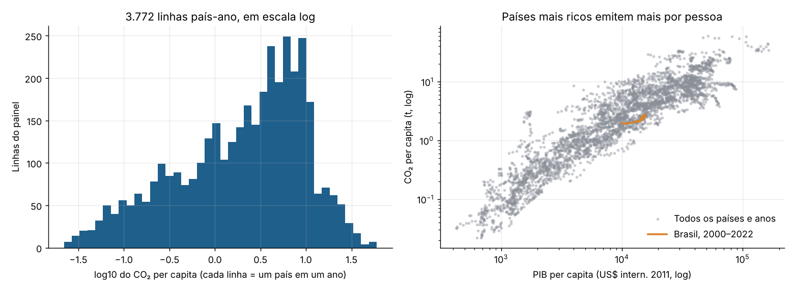

# CRISP-DM aplicado a emissões de CO₂ e desenvolvimento dos países

**Estudante:** Cléder Rafael Narciso de Araújo (trabalho individual) · **Disciplina:** Ciência de Dados e Aprendizagem de Máquina · Profa. Kadidja Valéria · UDF 2026.2

Roteiro no formato do *Guia Definitivo: O Modelo CRISP-DM*, aplicado a dados **reais e públicos** do [Our World in Data](https://github.com/owid/co2-data) (CC BY 4.0).

**Pergunta do estudo:** o que o nível de desenvolvimento de um país diz sobre quanto CO₂ ele emite por pessoa, e quais países conseguem reduzir esse valor ao longo de uma década?

[](https://colab.research.google.com/github/clederafael-crypto/Ciencia_Dados_Aprendizagem_Maquina/blob/main/Projeto_DataScience/notebooks/crisp-dm-co2.ipynb)

## A base de dados

| Tabela | Linhas | O que é |
|---|---|---|
| **Painel país-ano** | **3.772** | 164 países × 23 anos (2000–2022), com PIB, população, energia, metano e CO₂ per capita |
| **Janelas de 10 anos** | **2.132** | Atributos de um ano e o alvo "o CO₂ per capita caiu em 10 anos?" (13 janelas por país) |

A planilha **[`dados/planilha_base_de_dados.xlsx`](dados/planilha_base_de_dados.xlsx)** traz as duas tabelas completas e as descreve: resumo com as contagens, dicionário de cada coluna (unidade, origem, ausências, mínimo, média e máximo), estatísticas por ano com gráfico e os principais resultados. Tudo que é contagem ou estatística na planilha é fórmula.

## Resultados em resumo

| Tarefa | Resultado no teste (41 países nunca vistos) | Referência |
|---|---|---|
| **A. Regressão:** CO₂ per capita (943 linhas de teste) | Erro típico de ×1,23 (MAE 0,090 em log10), R² 0,97 | Prever a média: ×3,90 |
| **B. Classificação:** reduziu em 10 anos? (533 janelas de teste) | Acurácia 0,78, AUC 0,83 | Classe mais frequente: 0,67 |
| **C. Agrupamento** de 163 países em 2022 | 3 grupos, silhueta 0,533 | — |



- Só com o PIB per capita, o erro típico na validação é de cerca de ×1,65. A energia per capita reduz o erro, mas a relação é quase mecânica.
- O **Brasil** emite 2,29 t/pessoa em 2022; um modelo ajustado sem ele previu 3,96, e o Brasil ficou abaixo do previsto nos 23 anos. Entre 2012 e 2022 reduziu 9,6%, contra 3,7% do mundo.
- O mesmo país aparece em vários anos, então o treino e o teste foram separados **por país**. Mesmo assim, as janelas de um país se sobrepõem, e a incerteza real é maior que a sugerida pelo número de linhas. Todos os resultados descrevem **associações, não causas**.

## Partes

| Arquivo | Conteúdo |
|---|---|
| `00-pre-requisitos.md` | O que foi confirmado antes de começar |
| `01-entendimento-do-negocio.md` | Fase 1 |
| `02-entendimento-dos-dados.md` | Fase 2 |
| `03-preparacao-dos-dados.md` | Fase 3 |
| `04-modelagem.md` | Fase 4 |
| `05-avaliacao.md` | Fase 5 |
| `06-implantacao.md` | Fase 6 |
| `07-conclusoes-e-limitacoes.md` | Conclusões, limitações, próximos passos e declaração de uso de IA |
| `docs/DICIONARIO_DADOS.md` | Variáveis, unidades e fontes |

## Síntese prática: o fluxo do projeto

1. **Negócio:** entender o que distingue países que emitem mais ou menos do que o esperado.
2. **Dados:** base do OWID (56.269 linhas, 259 entidades; 223 países); painel de 3.772 linhas e 2.132 janelas.
3. **Preparação:** descartar 36 agregados, calcular PIB per capita e logaritmos, separar treino e teste por país.
4. **Modelagem:** regressão linear (A), regressão logística (B) e k-means (C), escolhidos por validação cruzada por país no treino.
5. **Avaliação:** teste usado uma vez; comparação com referências simples.
6. **Implantação:** código, notebook, planilha e testes reprodutíveis neste repositório.

## Como executar

```bash
pip install -r requirements.txt
python3 scripts/obter_dados.py      # opcional: baixa de novo os dados originais
python3 scripts/analise.py          # gera tabelas, figuras e resultados/resultados.json
python3 -m pytest tests -q          # confere a coerência dos dados e dos resultados
```

## Estrutura

```
Projeto_DataScience/
├── 00 … 07 (fases do CRISP-DM)
├── dados/planilha_base_de_dados.xlsx   planilha com os dados e a descrição
├── dados/brutos/       arquivo original do OWID e FONTES.json (procedência e hash)
├── dados/tratados/     painel, janelas, previsões e grupos (CSV)
├── scripts/            obter_dados.py e analise.py
├── notebooks/          crisp-dm-co2.ipynb (executado)
├── resultados/         resultados.json e tabelas de validação
├── figuras/            cinco figuras
├── docs/               dicionário de dados
└── tests/              testes de integridade
```

## Progresso

| Fase | Status |
|---|---|
| 1. Entendimento do Negócio | Concluído |
| 2. Entendimento dos Dados | Concluído |
| 3. Preparação dos Dados | Concluído |
| 4. Modelagem | Concluído |
| 5. Avaliação | Concluído |
| 6. Implantação | Concluído |

## Fontes

- OUR WORLD IN DATA. *CO₂ and Greenhouse Gas Emissions*. https://github.com/owid/co2-data. Licença CC BY 4.0. Baseado em Global Carbon Project, Energy Institute e Maddison Project Database.
- SCIKIT-LEARN. *User Guide*. https://scikit-learn.org/stable/user_guide.html.
